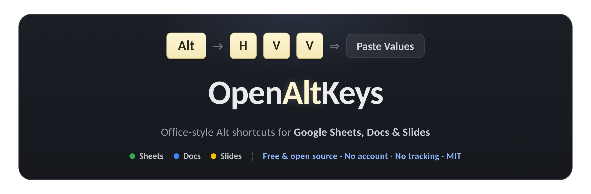
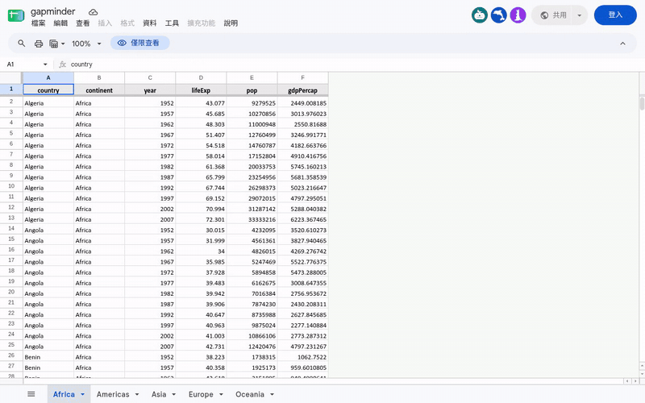
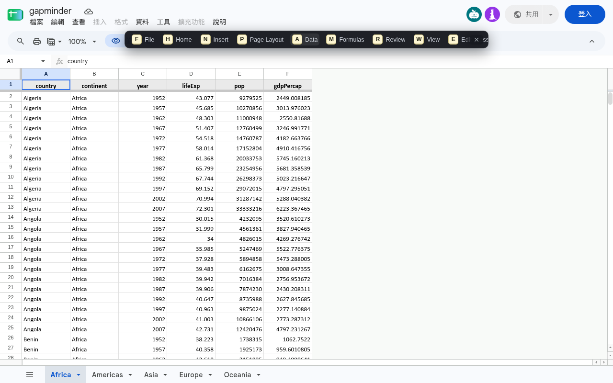
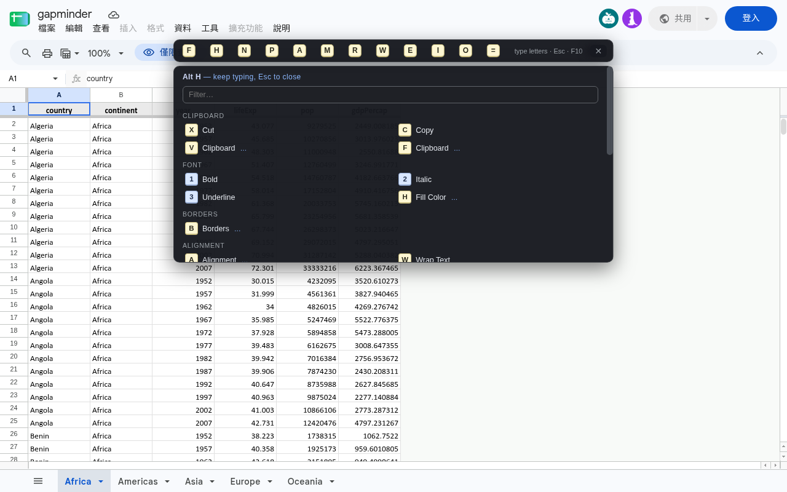
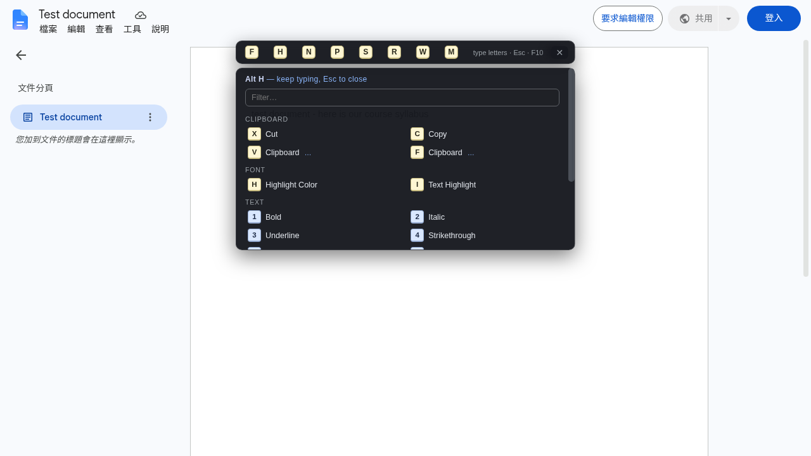
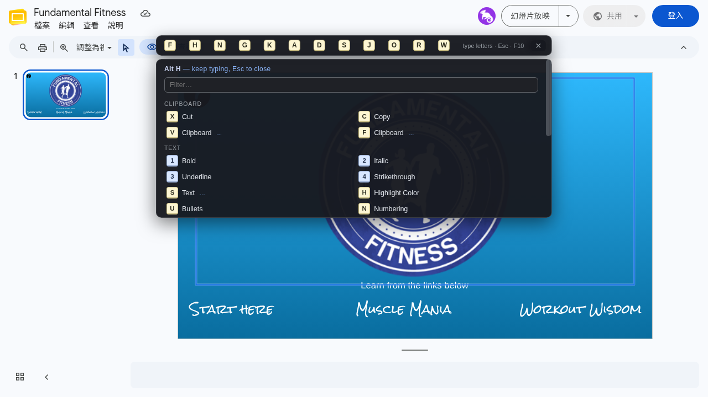

<p align="center">
  
</p>

<h1 align="center">OpenAltKeys</h1>

<p align="center">
  <b>Use the Office Alt-key sequences you already know — inside Google Sheets, Docs and Slides.</b><br>
  Tap <code>Alt</code>, type a few letters, done. Free forever · No account · No tracking
</p>

<p align="center">
  
  
  
  
  
  
  
</p>

<!-- After creating the repo, add repo-specific badges here, e.g.:
     stars / last-commit / chrome-web-store rating / firefox add-on rating -->
<!-- Repo social card: upload docs/social-preview.png in GitHub → Settings →
     Social preview (used for link unfurls on GitHub, X, Slack, …) -->

<p align="center">
  
</p>

<p align="center"><sub>A real Google Sheet — no staging, no cuts. Tap <b>Alt</b> → the key-tip strip appears → hover reveals labels → <b>H</b> opens the grouped panel → <b>Esc</b> closes.</sub></p>

---

**OpenAltKeys** brings Microsoft Office's ribbon key-tips to Google's editors.
`Alt` `H` `V` `V` pastes values. `Alt` `W` `F` `F` freezes panes. `Alt` `H` `O` `I` auto-fits a column.
If your hands learned these in Excel, Word or PowerPoint — they already work in Google Sheets, Docs and Slides.

## ✨ Highlights

| | |
|---|---|
| ⌨️ **True Alt-key sequences** | 395 sequences that mirror the Office ribbon — `Alt` then letters, exactly like Excel's key-tips |
| 🧰 **Real power tools** | Trace Precedents, Find Dependents, Goal Seek and a Symbol palette, all driven through Google's own UI |
| 🛟 **Heads-up auto-OK** | Google's “Heads up! … Edit anyway?” protected-range warning is confirmed for you — but only for commands OpenAltKeys itself ran, and it always tells you |
| 🛡 **Native combos pass through** | `Alt+/`, `Alt+1`, `Alt+Enter`, `Alt+F` are *Google's* shortcuts — never hijacked |
| 🔒 **Zero telemetry** | No accounts, no network calls, no analytics. Your toggles are the only thing it stores |
| 🪟 **Compact by default** | Badges-only strip, labels on hover, idle fade-to-ghost — tips never park over your work |
| ⌨ **Keyboard-first** | Every control reachable with `Tab`, panel has a live filter box, every sequence clickable |

## 📦 Install

**Chrome / Edge / Brave / Opera (Chromium)**

1. Download & unzip the release **`openaltkeys-v1.1.6.zip`** — `manifest.json` sits at the top level of the ZIP (or `git clone` this repo and use the folder as-is).
2. Open `chrome://extensions`.
3. Turn on **Developer mode** (top-right toggle).
4. Click **Load unpacked** and select the folder containing `manifest.json`.
5. Open any Google Sheet, Doc or Slide deck and tap **Alt**. That's the whole setup — no sign-in, no configuration.

**Firefox (109+)**

1. Download & unzip **`openaltkeys-firefox-v1.1.6.zip`**.
2. Open `about:debugging#/runtime/this-firefox`.
3. Click **Load Temporary Add-on…** and pick `manifest.json` from the unzipped folder.
   (Temporary add-ons are removed when Firefox restarts — a Firefox limitation for unsigned extensions.)
4. For a permanent install, the signed version from [addons.mozilla.org](https://addons.mozilla.org/) can be used once published; the package already carries the AMO-required `data_collection_permissions: none` declaration.

Both ZIPs ship the full source tree — `src/`, `tests/`, `scripts/`, `docs/`, `package.json` — so the whole test suite runs straight out of the unzipped package (see [Testing](#-testing)).

## ⌨️ Using it

| Input | What happens |
|---|---|
| Tap **Alt** (press & release) | The key-tip strip appears. Holding Alt while pressing another key is a *native Google* combo — always passed through untouched |
| Letters / digits | Walk the ribbon — e.g. `Alt` `H` `V` `T` = Paste Transposed |
| **Esc** / **Backspace** | Close / step back one letter |
| **Enter** | Run a "short" command immediately (Office-style deferral) |
| **F10** | Cycle tip modes: shown → ghost → hidden (turn off in Settings) |
| **F4** | Repeat the last command — never while you're editing, so Sheets' own F4 keeps working |
| **Tab** | Move focus into the bar: Tab cycles controls, Enter/Space activate, Esc returns to the page |
| **Ctrl + +/−** | Insert / delete rows & columns (Sheets only, row/column selected for you) |
| Disabled sequences | Settings lets you switch off any prefix (e.g. `HV` frees the whole Clipboard branch) — skipped on every path, no key ever typed |
| Protected ranges | Merging or editing a warned range pops Google's “Heads up! … Edit anyway?” dialog — OpenAltKeys auto-confirms it for its own commands (one per command, toast shown, toggle in Settings; native edits are never touched) |

<table>
  <tr>
    <td width="50%"><sub><b>Tap Alt</b> — the Office-style key-tip bar appears over the sheet.</sub></td>
    <td width="50%"><sub><b>Type H</b> — every continuation, grouped, filterable and clickable.</sub></td>
  </tr>
  <tr>
    <td width="50%"><sub><b>Google Docs</b> — the same Home panel, live (v1.1.5 frame fix).</sub></td>
    <td width="50%"><sub><b>Google Slides</b> — Alt sequences drive every editor the same way.</sub></td>
  </tr>
</table>

## 📊 Coverage

| | |
|---|---|
| Google Sheets | 176 sequences — 147 shortcuts, 18 guides |
| Google Docs | 92 sequences — 80 shortcuts, 4 guides |
| Google Slides | 127 sequences — 110 shortcuts, 5 guides |

Counts are verified against the data files by `tests/engine.test.mjs`, so this table can never silently drift. **Shortcuts** run a command; **guides** (marked `guide` in the cheat sheet) show instructions for actions Google has no shortcut or automation for — counted separately, never as shortcuts.

The popup also renders a **searchable cheat sheet** of every sequence, with per-app switches and a master switch.

## 🧰 Power tools (Google Sheets)

| Keys | Tool | What it does |
|---|---|---|
| `Alt` `M` `P` | **Trace Precedents** | Lists every cell/range the active formula uses — cross-sheet refs, whole-column and open ranges included — click one to jump to it |
| `Alt` `M` `D` | **Find Dependents** | Opens Find & Replace pre-filled with the active ref for formula search |
| `Alt` `A` `W` `G` | **Goal Seek** | Excel's what-if solver running entirely through Google Sheets' own UI — Illinois-method root finding, cancellation, checked restore on failure |
| `Alt` `N` `U` | **Symbol palette** | Click a symbol (Greek, math, arrows, currency, …) to type it into the cell — filter box included |

These are the same sequences desktop Excel uses, so your muscle memory carries over. Goal Seek reads values via the selection status bar, shows every trial value as it iterates, and tells you if restoring the original value failed (Ctrl+Z is the fallback).

**Why do my merges stall behind a "Heads up!" dialog?** That's Google's protected-range warning (Data ▸ Protect a sheet or range ▸ *Show a warning*) — it appears on *every* edit of a warned range, and Google ships no permanent off switch. OpenAltKeys confirms it automatically for commands you ran through the extension (`Alt H M M` merges without touching the mouse), shows a toast whenever it did, and leaves the dialog untouched for edits you made yourself. The toggle lives in Settings — “Heads-up auto-OK”.

## 🔒 Privacy — the short version

OpenAltKeys **collects nothing, sends nothing, and talks to no servers.**

- Stores only your on/off toggles and disabled-sequence list in `chrome.storage.sync`
- Content scripts run only on `docs.google.com` editor pages — no broader host access, no remote code
- The power tools read/write document data inside the page, on your command only — nothing is stored or transmitted
- Single permission: `storage`. You can verify all of this in the source — it ships in the package

Full policy: [`PRIVACY.md`](PRIVACY.md)

## 🏗 How it works

<details>
<summary><b>Architecture & dispatch cascade</b> — click to expand</summary>

<br>

```text
manifest.json          MV3, storage permission only — no remote code
src/
  data/sheets.js       Excel → Sheets sequences (+ custom handlers)
  data/docs.js         Word → Docs sequences
  data/slides.js       PowerPoint → Slides sequences
  content/engine.js    Alt state machine (leaf/menu/open/defer key-tip semantics)
  content/overlay.js   the key-tip UI (badge strip + grouped, filterable panel)
  content/menus.js     drives Google's own Closure menus (.goog-menu / aria-labels)
  content/dispatch.js  action executor: keyboard → menu → toolbar → tool-finder cascade
  content/sheetio.js   Sheets I/O helpers (name box, formula bar, status bar)
  content/dialogguard.js auto-confirms the "Heads up!" edit warning for extension-run commands (Sheets only)
  content/extras.js    Trace / Goal Seek / Symbol palette
  content/app.js       bootstrap: app detection + settings
  popup/ options/      cheat sheet + settings (all local)
  shared/cheatsheet.js one renderer shared by popup & options
  background.js        a stub — no servers, no accounts, no analytics
scripts/
  package_release.py   the release packager (npm run package)
```

Each shortcut is one line of data:

```js
E("HVV", "Paste Values", "Clipboard", ["k", "ctrl+shift+v"]);
E("WFF", "Freeze Panes", "View", ["x", "sheetsFreezeBoth"]);
```

Six dispatch kinds:

| spec | method |
|---|---|
| `["k", "ctrl+shift+v"]` | Google's own documented keyboard shortcut (synthesized) |
| `["m", "edit", "Paste special", "…"]` | opens Google's native menus and clicks the item |
| `["c", "Paint format"]` | clicks a toolbar button by accessible label |
| `["s", "Align left"]` | types into Google's tool-finder (Alt+/) and runs the match |
| `["x", "handler"]` | a custom handler (merge dropdowns, freeze both, resize dialogs, print, …) |
| `["t", "message"]` | a guide — shows instructions when no automation exists |

</details>

<details>
<summary><b>🧪 Testing — 400 automated checks</b> — click to expand</summary>

<br>

Everything ships in the ZIP, and every path in the suite is relative to the package — no absolute paths anywhere. From the package root:

```bash
npm install                            # dev-only: Playwright, for the browser suites
npm run test:unit                      # or: node tests/engine.test.mjs && node tests/extras.test.mjs
node tests/integration.mock.mjs        # 62 browser tests against a mock Google editor
node tests/integration.mocksheet.mjs   # 38 end-to-end commands on a functional mock sheet
node tests/smoke.extras.real.mjs       # 8 checks against a live public Google Sheet
node tests/integration.real.mjs        # 6 checks against a live public Google Sheet
```

The two unit suites need nothing but Node ≥ 18. Browser suites additionally need the Playwright download from `npm install` and launch a real Chromium window — on Linux run them inside a desktop session or under Xvfb (`xvfb-run node tests/integration.mock.mjs`); macOS and Windows work out of the box. The live-sheet suites skip gracefully when the network or the public test sheet is unavailable — they never pass silently.

Unit tests cover the tree builder, key-tip semantics, data integrity, README-count parity, the formula parser (cross-sheet, columns, open ranges), the goal-seek solver, locale-aware number parsing, status-bar Sum extraction, and the macOS modifier translation — pinned to Google's current Mac documentation. Browser tests run the real extension in Chromium and assert command *effects* (bold applied, `=SUM()` inserted, columns resized, precedents jumped to, Goal Seek solved, symbols typed, disabled sequences swallowing every key on every path), plus regression tests that native Alt-combos always pass through.

Three development-only scripts also ship in `tests/` but are not part of the suite: `screenshot.mjs` (re-takes the store screenshots), `control.noext.mjs` (page-error control run without the extension), and `probe.errors.mjs` (error-surface probe).

</details>

<details>
<summary><b>⚠️ Known browser limits</b> — honest engineering notes</summary>

<br>

- **Clipboard & print.** Browser security means no extension can synthesize trusted `Ctrl+C/X/V` or `Ctrl+P` keypresses. OpenAltKeys still sends the combo (the editors' own key handlers may accept it) and then tells you the real keys to press if nothing happened. Printing runs a real `window.print()` instead of a fake keypress.
- **macOS.** Every combo is sent the way Google documents it for Mac: `Ctrl` becomes `⌘` where Google's Mac shortcuts use it, insert/delete rows & columns go out as `⌘⌥= / ⌘⌥−`, Find & Replace as `⌘⇧H`, strikethrough as `⌘⇧X`, the tool finder opens with `⌥/`. Combos whose Mac form keeps the physical keys — Sheets borders `⌥⇧1..7`, select column `⌃Space`, number formats `⌃⇧1..6` — are sent unchanged. A handful of punctuation-based shortcuts may still differ on non-US keyboards.
- **Non-English UIs.** Menu-path and toolbar commands match English labels (Google exposes no locale-independent command API). Keyboard and custom-handler entries work everywhere; label-based entries show a hint when the UI language isn't English.

</details>

## 🗺 Roadmap

- [ ] Per-shortcut remapping (today: disable any sequence prefix in Settings)
- [ ] Translated UI + locale-aware menu matching
- [ ] Size/position preference (compact vs roomy, top vs bottom dock)
- [ ] More rarely-used Office sequences — the framework makes each a one-line change

## 🤝 Contributing

Add a line to the right data file and reload the extension — that's it. The engine, overlay, tests and cheat sheet pick it up automatically, and `tests/engine.test.mjs` validates the database (it even checks that the counts in this README match the data).

```bash
git clone https://github.com/<your-username>/openaltkeys.git
cd openaltkeys
npm install && npm run test:unit   # Node ≥ 18 is the only requirement
```

Pull requests welcome — run the unit suites before submitting.

## ⚖️ License

MIT — see [`LICENSE`](LICENSE).

Microsoft Office, Excel, Word, PowerPoint, Google Sheets, Google Docs and Google Slides are trademarks of their respective owners. This project is not affiliated with or endorsed by Microsoft or Google.

---

<p align="center"><sub>If OpenAltKeys saves you clicks, ⭐ the repo — it helps others find it.</sub></p>
